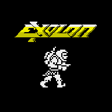
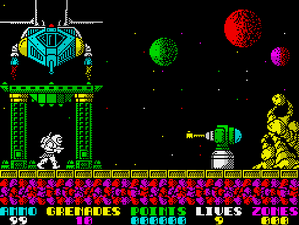
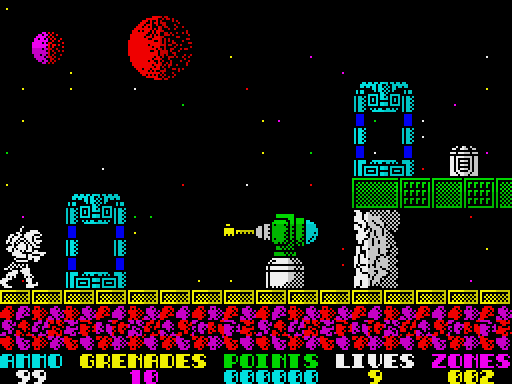
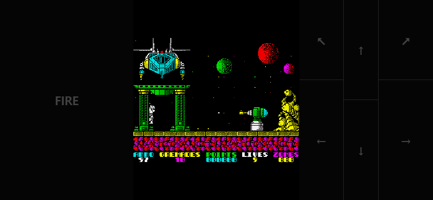
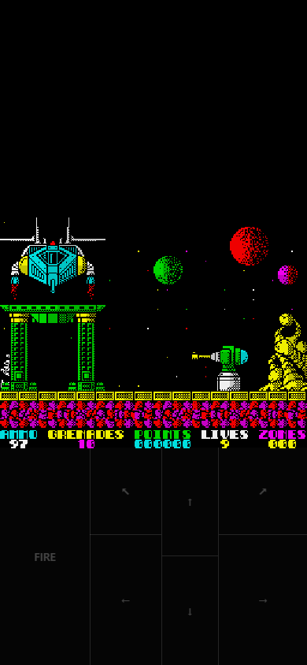

[](https://github.com/gagarinbefree/Exolon/actions/workflows/web.yml)
[](https://github.com/gagarinbefree/Exolon/actions/workflows/web.yml)
[](https://github.com/gagarinbefree/Exolon/releases/latest)
[](https://gagarinbefree.github.io/Exolon/)

<p align="center">
  
</p>

<h1 align="center">Exolon</h1>

<p align="center">
  
</p>

<p align="center">
  An in-progress Godot 4 / C# remake of the 1987 ZX Spectrum action game, based on the melonJS version of Exolon.
</p>

<p align="center">
  <a href="https://gagarinbefree.github.io/Exolon/"><strong>Play in your browser</strong></a>
  &nbsp; · &nbsp;
  <a href="https://github.com/gagarinbefree/Exolon/releases/latest"><strong>Download for Android</strong></a>
</p>

## Scenario

Guide Vitorc across hostile alien terrain, from one screen to the next. Enemy creatures, turrets, mines, missiles and machinery stand in your way. Use the blaster against approaching enemies, launch grenades at armoured obstacles and find a route through each zone.

Along the way, Vitorc can enter an exoskeleton capsule. The armour provides extra protection and a double blaster shot, but completing a level without it earns a bravery bonus.

This remake currently contains **three levels of 25 zones**. All 75 zones can be opened in the Godot editor. The game is still being checked against the melonJS version and has not yet had a complete manual playthrough.

## Screenshots

| Zone 1 | Zone 3 |
| :---: | :---: |
|  |  |

Touch controls adapt to the orientation of your phone or tablet:

<table>
  <tr>
    <th>Landscape</th>
    <th>Portrait</th>
  </tr>
  <tr>
    <td align="center"></td>
    <td align="center"></td>
  </tr>
</table>

## Loading

### Browser and PWA

Open **[Play Exolon](https://gagarinbefree.github.io/Exolon/)** in a browser with WebGL 2 support. Wait for the game to load, then press **Space** or tap **FIRE** on the title screen.

To add the game to your home screen:

- **Android:** open the browser menu and choose **Install app** or **Add to Home screen**.
- **iPhone / iPad:** tap **Share**, then **Add to Home Screen**.

The installed PWA opens in its own window and currently requires an internet connection to play.

### Android APK

Download the latest signed APK from [GitHub Releases](https://github.com/gagarinbefree/Exolon/releases/latest) and install it on your Android device. Depending on your device, Android may ask you to allow installation from the app used to open the APK.

Versioned APKs are also published in [GitHub Packages](https://github.com/gagarinbefree/Exolon/packages/3372432) and as Actions artifacts. Downloading from the Maven registry requires GitHub authentication.

### Godot editor

Open `project.godot` in Godot 4.7.2 .NET, build the C# project with the .NET 10 SDK and run the main scene.

## Controls

### Keyboard

| Key | Action |
| --- | --- |
| Left / Right | Walk |
| Up | Jump, use a teleport or enter an armour capsule |
| Down | Duck |
| Space | Fire the blaster; hold to launch a grenade |

Press **Space** on the title screen to start. Use **Up** while inside a teleport or armour capsule to activate it. Press fire again on the bonus screen to stop the pointer.

### Touchscreen

The **FIRE** area is on the left; the direction areas are on the right. Tap to fire or hold to launch a grenade. Touch a diagonal-up area to jump in that direction, and use a second finger to fire while moving.

On a phone or tablet, controls appear below the game in portrait orientation and beside it in landscape orientation. The PWA and Android APK each provide their own touch controls; desktop play uses the keyboard. See the [control layout](docs/virtual_keyboard.txt) for the complete arrangement.

## Playing the game

### Blaster

A short press fires the hand blaster. Use it against alien creatures and other vulnerable targets. Keep an eye on the **AMMO** counter; ammunition packs refill it.

### Grenades

Hold fire for approximately half a second to launch a grenade. Grenades are useful against turrets and other heavy obstacles. Grenade packs replenish the **GRENADES** counter.

### Exoskeleton

Enter an armour capsule and press **Up** to change outfit. The exoskeleton fires two blaster shots at once and protects Vitorc from some hazards; it does not make him invulnerable.

### Teleports and supplies

Some zones contain a pair of teleports. Stand inside one and press **Up** to travel to the other. Collect ammunition and grenade packs when your supplies run low. The status panel shows ammunition, grenades, points, lives and the current zone.

## Scoring

| Action | Points |
| --- | ---: |
| Destroy an ordinary obstacle with a grenade | 150 |
| Destroy a large alien | 150 |
| Destroy a released egg or a launcher projectile | 50 |
| Capture a double launcher | 2,000 |
| Capture a combined launcher | 3,000 |
| Destroy a missile guidance unit | 1,000 |

At the end of each level, each remaining life is worth **1,000 points**. Finishing without the exoskeleton adds a **10,000-point bravery bonus**. An extra life is awarded after the bonus screen, up to a maximum of nine.

## Development and tests

The browser build runs the C# game through the experimental [2dog](https://github.com/outfox/2dog) WebAssembly host. It uses the single-threaded Compatibility renderer. To build and serve it locally with the .NET 10 SDK and Python:

```sh
dotnet workload install wasm-tools
dotnet publish Exolon.web --configuration Release
python -m http.server 18765 --directory Exolon.web/AppBundle
```

Open `http://127.0.0.1:18765/`. The test and deploy workflow runs the non-graphical Godot scenarios before release builds, then checks browser startup, touch controls and PWA installation. The render-dependent screenshot scenarios remain available for local use.

The [workflow](https://github.com/gagarinbefree/Exolon/actions/workflows/web.yml) builds a signed Android APK after successful checks on `main`, using version `0.1.<run number>`. Android uses the official Godot 4.7.2 .NET 9 export template; the web build uses .NET 10 and 2dog. Before a local Android export, run:

```sh
python tools/get_android_template.py .godot/android_release.apk
python tools/prepare_android_project.py
```

Android release signing requires the `ANDROID_KEYSTORE_BASE64`, `ANDROID_KEY_ALIAS` and `ANDROID_KEYSTORE_PASSWORD` repository secrets. Keep a secure backup of the original keystore and password: app updates must use the same signing key.

Maps are kept as individual TMX files in `assets/maps`, with a preview scene for each zone in `scenes/zones`. Godot does not display the TMX files in its FileSystem dock without an importer; open the corresponding scene to preview a zone or use Tiled to edit a map. To reimport assets from the adjacent melonJS checkout on Windows, run `pwsh -File tools/import-melon-assets.ps1`.

## Credits

The original Exolon was created by Raffaele Cecco and published by Hewson Consultants in 1987. This project is a work-in-progress Godot / C# port based on the melonJS remake. Original assets and maps are used for comparison and attribution; see [LICENSE.melonjs](LICENSE.melonjs) for the upstream license.

The structure of this guide follows the [original instructions](https://worldofspectrum.net/pub/sinclair/games-info/e/Exolon.txt), adapted for the controls and platforms of this version.

## Links

- [Exolon melonJS remake — newagebegins/exolon](https://github.com/newagebegins/exolon)
- [Original Exolon — World of Spectrum](https://worldofspectrum.org/software?id=0001686)
